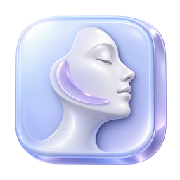

> 此仓库提供支持 macOS 的软件源码，不包含个人资料或原仓库历史。请按下文构建；原仓库发行链接已转为私有归档，本源码副本尚未发布安装包。

# 人生重塑计划 · Life Reshape Plan



一个本地优先的桌面生活记录工具，把认知唤醒、视频跟练、力量训练、护肤、饮食与睡眠放在同一个工作台里。视频按独立板块收藏，既可以保留原有瘦脸护理，也可以导入晨间励志、晚间复盘视频，并创建自己命名的收藏夹。使用 Electron 构建，以半透明界面和生成的 3D 图标呈现每日计划与长期进步。

当前源码版本：**1.8.5**。支持 **macOS 13+** 与 **Windows 10 / 11 x64**。Windows 安装包和免安装 ZIP 见 [发布页](https://github.com/SJT-bright/face-reshape-plan/releases/tag/v1.8.5)，运行与构建步骤见 [Windows 使用说明](WINDOWS-使用说明.md)。两个平台使用同一套 MIT 开源源码。

## 功能

| 栏目 | 可以做什么 |
| --- | --- |
| 今日与视频跟练 | 汇总今日安排；导入 B 站 BV 号、链接、抖音分享口令或本地视频（抖音自动下载成本地视频）；沉浸播放、计时、暂停、结束记录和到点提醒 |
| 认知唤醒与自定义视频板块 | 在瘦脸护理、认知唤醒及自命名收藏夹间切换；各自导入和收藏视频；设置早上、晚上或两个时段；独立记录观看 |
| 跟练计划 | 按行导入计划，编辑星期、时间、时长和绑定视频；调整每日累计目标 |
| 力量训练 | 训练模板与版本、周期轮转、逐组记录组数/次数/负重或自重、历史补记、递进建议、文本/JSON 导入导出 |
| 成长与肌群 | 成长曲线、训练历史、模板更新记录、11 个肌群的身体图与详情、训练量及估算力量趋势 |
| 护肤与皮肤状态 | 周期护肤计划、早/日/晚打卡、皮肤状态自评、照片档案、皮肤与体型照片分类 |
| 可选 AI 识图 | 自配智谱 API Key，默认手动触发；可明确开启自动模式；结果先预填，由用户确认保存，密钥经系统加密存储 |
| 饮食与睡眠 | 记录大致吃饭时间；早上按手环填写入睡、起床时间及实际睡眠时长；查看节律统计与方向性提示 |
| 成就月历 | 按年月浏览，星期与日期对齐；查看每日训练时长、达标状态和明细，按所选日期补记 |
| 设置与备份 | 共享个人资料、模块启用、目标历史、外观、勿扰、今日提醒时间线、完整备份与恢复 |
| 桌面交互 | 单列半透明侧栏、3D 图标和按钮、窗口拖动区域、托盘与系统提醒 |

力量训练有「今日训练 / 成长曲线 / 训练日模板 / 训练历史 / 模板更新记录 / 进步可视化」六个视图。训练模板编辑会生成新版本，历史记录保留原有快照。

切换到「认知唤醒」后再导入励志、觉醒或复盘视频；导入只进入当前视频板块。两边各导入 5 个视频时，各自显示 5 个。同一个视频也可分别加入不同收藏夹；认知唤醒和自定义收藏夹的观看记录独立于瘦脸训练时长与训练目标。旧视频继续归入「瘦脸护理」。

健康相关分数、相关性与 AI 识图均是记录辅助或规则估算，不用于诊断，也不能据此判断体脂变化、局部减脂效果或实际肌肉增长。研究资料和计算口径见 [饮食与睡眠规则](docs/饮食与睡眠-证据与计算规则.md) 及源码中的对应引擎。

## 运行

需要 Node.js **22.16.0 或更高**（建议 24 LTS）、npm，以及图形桌面环境。Electron 版本锁定为 **44.3.0**。

```bash
git clone https://github.com/SJT-bright/face-reshape-plan.git
cd face-reshape-plan
npm ci
npm start
```

运行项目时使用 `npm start`，直接打开依赖目录内的 `Electron.app` 会进入 Electron 欢迎页。

```bash
npm run test:unit   # 无需 GUI 的领域逻辑和模块流程测试
npm test           # 包含真实 Electron 窗口与隔离资料目录的集成测试
npm run test:ux20  # 20 项体验回归、隔离窗口与实际媒体位置恢复
npm run test:media # 跨域播放器集成（本地合成服务）
npm run dist:mac   # 在 Mac 上生成 App、DMG 和 ZIP，输出到 dist/
npm run dist:win   # 在 Windows 上生成 x64 安装包，输出到 dist/
```

本仓库发布源码和所需静态素材。Windows 发布页提供安装包、完整免安装 ZIP 和 SHA-256 校验值。Mac 签名与环境说明见 [MAC-使用说明.md](MAC-使用说明.md)。

每日训练目标入口：**设置 → 目标与外观 → 今日起每日跟练目标 → 保存设置**。使用与迁移说明见 [20 项优化使用说明](docs/20项体验优化-使用与迁移说明.md)。

## 数据与网络

应用显示名称已改为「人生重塑计划」，原有资料与媒体位置保持兼容。macOS 的默认资料目录固定为：

```text
~/Library/Application Support/面部重塑计划/
├── face-reshape-data.json  记录与设置
├── ai-key.enc              系统加密后的可选 AI 密钥（不进入备份）
└── hub-today.json          提供给本地中控工具的今日任务摘要

项目目录/面部重塑计划/
├── 皮肤照片/               皮肤照片
├── 健身照片/               健身 / 体型照片
└── 跟练视频/               导入时复制的本地跟练视频
```

Windows 记录与媒体保存在 `%APPDATA%\面部重塑计划\`：记录仍为 `face-reshape-data.json`；皮肤、体型、餐食照片与复制的视频分别在 `skin-photos`、`body-photos`、`meal-photos`、`imported-videos`，不写入安装目录。

在 **设置 → 数据与备份** 导出 `.frbackup` 完整包，包含记录与照片；本地视频可选择包含文件或只保留引用。跨系统恢复会生成当前系统路径。引用模式需另行保留原视频。自动 JSON 备份不包含照片与视频，界面显示其覆盖范围和最近成功时间。恢复前会检查清单与哈希，并保存当前数据快照。

新应用、窗口、托盘与导出备份使用「人生重塑计划」名称。资料目录、`face-reshape-data.json`、旧 `.frbackup` 格式以及 `com.faceshape.plan` 应用标识保持兼容，原记录、照片、设置和 Chromium 本地草稿仍从原位置读取。源码目录及仓库地址继续沿用旧名称。`FACE_RESHAPE_PROFILE` 可覆盖资料目录，用于独立验收。

- 普通记录无需账号。B 站资料获取和官方嵌入播放器需要联网；抖音导入需要联网：粘贴分享口令或链接后应用会解析视频并自动下载到本地视频库，下载成功后直接播放本地文件，再次观看无需解析抖音地址。下载失败会显示原因，可仅重试失败项；旧抖音引用启动后自动补下载，保留原板块和观看记录。
- AI 识图是可选功能，手动点击或用户已启用的自动模式会将当天最新皮肤照片发送给智谱。界面标明照片日期和模型，结果确认前不计入正式记录。密钥由使用者自行提供，采用 Electron 系统安全存储加密；旧明文仅在加密并回读成功后清理。默认备份不含密钥。
- 可选的旧库睡眠迁移只读本机 LifePivot 数据库；没有该应用也可以正常记录。力量历史迁移脚本见 `scripts/export-strength-from-life-pivot.py`。
- Git 忽略个人数据库、照片、密钥文件、备份、构建产物和本机代理工作记录。开源仓库不包含作者的健康记录或 API Key。

## 项目结构

```text
main.js                    窗口、IPC、存储、通知、照片与 AI 请求
preload.js                 渲染页面与主进程之间的桥接
src/js/app.js              页面路由、跟练计时
src/js/store.js            本地数据与派生统计
src/js/strength-core.js    力量训练领域模型、递进建议与趋势计算
src/js/strength.js         力量训练界面、导入和图表
src/js/skin-engine.js      皮肤记录与趋势规则
src/js/skincare.js         护肤与照片界面
src/js/rhythm-engine.js    饮食、睡眠统计
src/js/rhythm-evidence.js  节律规则与来源
src/js/achievement-calendar.js  达标月历
src/assets/               背景、身体图、3D 素材与原始图
scripts/                  图标处理、迁移与开发工具
tests/                    领域逻辑、模块流程和 Electron 集成测试
docs/                     计算口径、素材来源和更新记录
```

## 每日自动跟练与护肤

在「设置 → 视频板块」新增和编辑自己的板块。「设置 → 自动流程」可为早上、晚上分别预选视频、开始时间和重复星期，再开启到点全屏跟练。启用后应用常驻托盘，保持运行才能准时启动；电脑睡眠或锁屏时不会强行启动摄像头。

训练视频结束后进入皮肤状态截取，再进入对应时段的护肤步骤。默认手动点击截取，可开启自动截取，照片标记为「训练后 · 护肤前」。镜头画面仅本机预览，照片写入原皮肤图库；不录制视频或麦克风。首次使用需允许摄像头；Windows 可直接打开系统摄像头权限设置。可以随时关闭镜头或退出全屏流程。

板块页顶部的早晚按钮选择对应预设视频，未设置时打开配置页。左侧筛选按板块适用时段筛选，不把同一板块的视频拆成两份。

## 最新进展与验证

截至 **2026-10-11**，源码同步认知计划、独立早晚视频槽位、拍摄档案、柔和控件，并补齐 Windows 适配与自动构建发布。原有耐力评分、护肤成分搭配检查、成长计划和力量训练递进建议继续保留。此前 20 项体验改进的测试与边界见 [验收清单](docs/20项体验优化-验收清单.md)，具体变化见 [更新记录](CHANGELOG.md)。

本次发布使用当前工作区源码；此前本机直接更新过应用归档，应用外层版本号与源码版本曾不同，不能以旧安装包推断最新功能。测试与未验证范围记录于 [发布检查](docs/开源发布检查.md)。

## 许可证与素材

采用 [MIT License](LICENSE)。3D 图标及按钮的生成提示词、原图和处理结果随源码提供，见 [素材说明](docs/3D素材与提示词.md) 与 [素材清单](docs/3d-assets-manifest.json)。身体示意图来自作者此前的力量训练模块。

第三方依赖保留各自许可证；用户自行导入的视频、照片和第三方服务内容不属于本项目许可范围。
